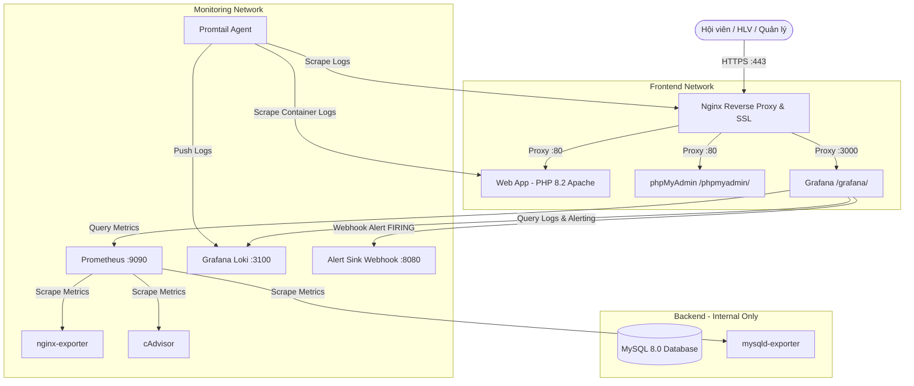

# Hệ Thống Quản Lý Phòng Gym & Thể Thao (Gym & Fitness Management System)
### Đồ án Môn học: Triển khai và Quản trị Hệ thống Phần mềm (DevOps & An toàn Hệ thống)
### Đề tài số: 23

---

## 📌 THÔNG TIN SINH VIÊN THỰC HIỆN
- **Họ và tên sinh viên:** **Trần Thị Thu Huyền**
- **Mã số sinh viên (MSSV):** **DTC245180013**
- **Lớp / Khóa:** **CNTT K23C**
- **Email:** `dtc245180013@ictu.edu.vn`
- **Tài khoản GitHub:** [`dtc245180013-droid`](https://github.com/dtc245180013-droid)
- **Repository:** [`https://github.com/dtc245180013-droid/DTC245180013`](https://github.com/dtc245180013-droid/DTC245180013)
- **Trường:** Đại học Công nghệ Thông tin và Truyền thông – Đại học Thái Nguyên (ICTU)

---

## 1. Giới Thiệu Dự Án
Hệ thống quản lý phòng Gym và thể thao toàn diện được xây dựng trên kiến trúc Multi-Container Docker Compose với đầy đủ các tiêu chuẩn bảo mật, giám sát hiệu năng thời gian thực, thu thập log tập trung và cảnh báo sự cố an toàn thông tin tự động theo đúng yêu cầu Đề tài 23.

---

## 2. Kiến Trúc Hệ Thống (Architecture Diagram)



---

## 3. Cấu Trúc Thư Mục Hệ Thống (Directory Structure)

```text
gym/
├── .env.example              # Tệp mẫu khai báo biến môi trường
├── .gitignore                # Khai báo loại trừ tệp bí mật khỏi Git
├── docker-compose.yml        # Cấu hình khởi chạy toàn bộ 12 dịch vụ container
├── README.md                 # Tài liệu hướng dẫn hệ thống
├── alert-sink/               # Phân hệ Webhook tiếp nhận cảnh báo sự cố
│   ├── Dockerfile
│   └── server.py
├── db/                       # Khởi tạo CSDL MySQL (7 bảng nghiệp vụ Gym)
│   └── init.sql
├── nginx/                    # Cấu hình Reverse Proxy, SSL HTTPS và Rate Limit
│   ├── certs/
│   └── nginx.conf
├── prometheus/               # Cấu hình thu thập chỉ số giám sát hệ thống
│   └── prometheus.yml
├── grafana/                  # Cấu hình Datasources và 4 Dashboards giám sát
│   └── provisioning/
├── loki/                     # Cấu hình hệ thống lưu trữ log tập trung
│   └── loki-config.yaml
├── promtail/                 # Cấu hình thu thập nhật ký từ các container
│   └── promtail-config.yaml
├── scripts/                  # Scripts kiểm tra hồi quy và mô phỏng sự cố
└── web/                      # Phân hệ Web Quản lý Phòng Gym (PHP 8.2)
    ├── Dockerfile
    └── src/                  # Mã nguồn giao diện và xử lý nghiệp vụ
```

---

## 4. Công Nghệ Sử Dụng (Tech Stack)

| Phân hệ | Công nghệ & Phiên bản | Chức năng chính |
| :--- | :--- | :--- |
| **Reverse Proxy** | `nginx:1.27-alpine` | Reverse proxy HTTPS (TLS 1.2/1.3), tự động chuyển hướng HTTP 301, chặn 7 cổng nhạy cảm, áp dụng 7 Security Headers |
| **Web Application** | `php:8.2-apache` | Ứng dụng quản trị phòng gym thuần PHP PDO, CSRF token, XSS sanitize, phân quyền 3 vai trò, biên lai thanh toán, Bootstrap 5 UI |
| **Database** | `mysql:8.0` | CSDL quan hệ 7 bảng (users, members, packages, trainers, memberships, schedules, bookings), InnoDB, bcrypt hashing |
| **DB Admin** | `phpmyadmin:5.2.1` | Giao diện quản trị CSDL qua reverse proxy tại `/phpmyadmin/` |
| **Giám sát Metrics** | `prom/prometheus:v2.53.0` | Thu thập metrics định kỳ từ các exporter |
| **Hiển thị Dashboard** | `grafana/grafana:11.1.0` | Trực quan hóa dữ liệu với 4 dashboards tự động nạp (provisioned) |
| **Container Metrics** | `cadvisor:v0.49.1` | Giám sát CPU, RAM, Network, I/O của toàn bộ 12 containers |
| **Nginx Metrics** | `nginx-prometheus-exporter:1.1.0` | Thu thập active connections, request rate qua `stub_status` |
| **MySQL Metrics** | `prom/mysqld-exporter:v0.15.1` | Thu thập query throughput, connection pool, buffer pool |
| **Thu thập Log** | `grafana/loki:3.1.0` | Cơ sở dữ liệu log tập trung (LogQL) |
| **Log Shipper** | `grafana/promtail:3.1.0` | Quét log Docker container và gán nhãn tự động (`webapp`, `nginx`, `mysql`) |
| **Bộ thu Cảnh báo** | Custom Python HTTP Server | Endpoint tiếp nhận webhook JSON từ Grafana Alertmanager |

---

## 5. Danh Sách Tài Khoản & Mật Khẩu (Credentials)

### 5.1. Tài khoản Đăng nhập Ứng dụng Gym (`https://<IP>/login.php`)
| Vai trò | Tên đăng nhập | Mật khẩu mặc định | Quyền hạn |
| :--- | :--- | :--- | :--- |
| **Quản lý (Manager)** | `admin` | `Gym@2026!` | CRUD Hội viên, Gói tập, HLV, Lịch tập, Gia hạn gói, Xuất biên lai, Báo cáo doanh thu |
| **Huấn luyện viên** | `hlv01` .. `hlv05` | `Gym@2026!` | Xem ca dạy của mình, xem danh sách học viên đăng ký, điểm danh hội viên |
| **Hội viên (Member)** | `hoivien01` .. `hoivien15` | `Gym@2026!` | Xem hồ sơ gói tập, đặt chỗ lớp tập (SELECT FOR UPDATE chống overbooking), hủy đặt chỗ |

### 5.2. Dịch vụ Hạ tầng & Giám sát
- **Grafana URL:** `https://<IP>/grafana/` (hoặc `http://localhost:3000`)
  - Tài khoản: `admin` / Mật khẩu: `GymGrafanaP@ss2026!`
- **phpMyAdmin URL:** `https://<IP>/phpmyadmin/`
  - Tài khoản: `gym_app` / Mật khẩu: `GymAppP@ss2026!` (hoặc root: `GymRootP@ssw0rd!2026`)
- **MySQL Root:** `root` / `GymRootP@ssw0rd!2026`
- **SSH Quản trị VM:** `huyenxinh@192.168.233.128` (Cổng SSH: **2849**)

---

## 6. Hướng Dẫn Cài Đặt & Vận Hành (Quick Start)

### 6.1. Khởi tạo môi trường
```bash
# 1. Clone repository
git clone https://github.com/dtc245180013-droid/DTC245180013.git ~/gym
cd ~/gym

# 2. Tạo chứng chỉ SSL tự ký
chmod +x nginx/gen-cert.sh
./nginx/gen-cert.sh

# 3. Tạo file cấu hình môi trường .env (nếu chưa có)
cp .env.example .env

# 4. Khởi chạy toàn bộ hệ thống
docker compose up -d --build
```

### 6.2. Kiểm tra trạng thái
```bash
# Kiểm tra danh sách 12 container
docker compose ps

# Kiểm tra sức khỏe ứng dụng
curl -sk https://localhost/health.php
```

---

## 7. Giám Sát & Truy Vấn Nhật Ký (Monitoring & LogQL)

### 7.1. Các Dashboard Grafana đã nạp sẵn
1. **GYM - Containers:** Giám sát CPU/RAM thực tế của từng container (cAdvisor).
2. **GYM - Nginx:** Giám sát lưu lượng HTTP request, active connections, status codes.
3. **GYM - MySQL:** Giám sát số lượng truy vấn, kết nối hiện thời, bộ nhớ đệm InnoDB.
4. **GYM - Logs:** Truy vấn trực quan log của Webapp và Nginx qua Grafana Loki.

### 7.2. Các truy vấn LogQL mẫu (Thực hiện trong Grafana Explore hoặc Loki API)
- **Truy vấn lỗi 5xx trên Nginx:**
  ```logql
  {job="nginx"} |~ " (500|502|503|504) "
  ```
- **Truy vấn ngoại lệ / lỗi trên Web Application:**
  ```logql
  {job="webapp"} |~ "(?i)(error|exception|failed)"
  ```
- **Truy vấn hành vi đăng nhập sai (Brute-Force Detection):**
  ```logql
  {job="webapp"} |= "LOGIN_FAILED"
  ```
- **Đo lường tần suất đăng nhập sai trong 5 phút (Metric LogQL):**
  ```logql
  sum(count_over_time({job="webapp"} |= "LOGIN_FAILED" [5m]))
  ```

---

## 8. Kịch Bản Giả Lập Tấn Công & Cảnh Báo (Incident Scenario)

```bash
# Chạy script giả lập 20 lượt đăng nhập sai liên tiếp vào tài khoản admin:
bash scripts/simulate_bruteforce.sh

# Kiểm tra webhook cảnh báo được gửi tới Alert Sink:
docker logs gym_alert_sink
```
Alert Rule `GYM - Brute force login` trong Grafana sẽ tự động chuyển trạng thái `FIRING` khi tần suất đăng nhập sai vượt quá 5 lần/phút, và bắn webhook JSON HTTP POST về `http://alert-sink:8080/`.

---

## 9. Các Biện Pháp Gia Cố Bảo Mật (Security Hardening)
1. **Phân vùng mạng 3 lớp (Network Segmentation):** Tách biệt `frontend`, `backend` (`internal: true`), và `monitoring`. Database `gym_db` hoàn toàn không bị Nginx hay bên ngoài kết nối trực tiếp.
2. **Đặc quyền tối thiểu CSDL (Least Privilege):** Tài khoản `gym_app` chỉ có quyền `SELECT, INSERT, UPDATE, DELETE` trên CSDL `gym.*`. Thu hồi toàn bộ quyền `DROP, ALTER, CREATE`.
3. **Hạn chế đặc quyền & Tài nguyên Container:** Bật `no-new-privileges:true`, giới hạn cứng CPU và RAM cho từng container. Web service chạy với người dùng `www-data`.
4. **Che giấu thông tin phiên bản (Information Disclosure Mitigation):** Tắt `expose_php`, ẩn `ServerTokens Prod`, `ServerSignature Off`, `server_tokens off;`.
5. **Tường lửa máy chủ (UFW):** Chỉ mở cổng 80, 443 và cổng SSH tùy biến 2849. Các cổng dịch vụ phụ (3306, 9090, 3000, 3100, 8080, 8081) đóng hoàn toàn.